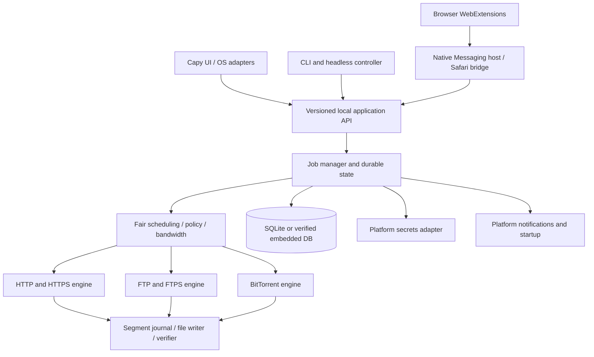

# Speed Download — Project Specification

> **Status:** Proposed / architecture and feasibility phase  
> **Product name:** Speed Download (`speed-download` CLI)
> **Type:** Free, open-source, cross-platform desktop download manager  
> **Primary language:** Zig  
> **GUI toolkit:** Capy UI (required; platform readiness must be validated)  
> **Document version:** 0.1 — 2026-10-11  
> **Related:** [Agent.md](Agent.md)

## 1. Vision

Build a fast, resilient, privacy-respecting download manager that feels native on macOS, Windows, and Linux while keeping its download engine usable independently of the GUI. The application supports HTTP, HTTPS, FTP, and BitTorrent; intelligently downloads different portions of large files in parallel when supported; resumes safely after failures; and integrates with browsers and operating-system services without intrusive tracking.

**Product principles:**

1. **Correctness before acceleration.** Never sacrifice data integrity to increase speed; do not claim that parallel requests always make downloads faster.
2. **Native where it matters.** Respect each platform's human-interface guidance, accessibility model, notification service, secret storage, startup mechanism, and system tray/menu bar conventions.
3. **One download engine, multiple front ends.** GUI, command-line/headless process, and browser bridges use one documented core service API.
4. **Transparent control.** All interception, auto-start, scheduling, bandwidth rules, and post-download actions are user-configurable and reversible.
5. **Security and privacy by default.** Credentials remain in OS-protected storage; no telemetry or cloud account is required; secrets do not enter logs or persistent download records.
6. **Community maintainability.** Document public APIs, invariants, decisions, platform exceptions, and tests. Keep builds reproducible and source code readable.

## 2. Scope and target support

### 2.1 Architecture matrix

| OS | CPU targets | Desired product support | Engineering status / caveat |
|---|---|---|---|
| macOS | Intel x86_64; Apple Silicon aarch64 | GUI + engine + integration | **Blocked pending Capy backend validation.** Capy currently labels both as planned. |
| Windows | x86 (32-bit i386); x86_64; ARM64 aarch64 | GUI + engine + integration | Capy advertises i386 and x86_64; **ARM64 GUI must be prototyped and verified**. |
| Linux | x86 (32-bit i386); x86_64; ARM64 aarch64 | GUI + engine + integration | Capy advertises these three; verify distro-specific GTK4 and packaging requirements. |
| Linux | 32-bit ARM (e.g., armv7) | Stretch target, engine first | Architecture and distro ABI support, GUI dependencies, and CI runners must be assessed separately. |

The word *x86* includes **both 32-bit and 64-bit** Windows and Linux targets. On modern macOS, only 64-bit Intel and Apple Silicon are in scope: macOS 10.15 and later cannot run 32-bit macOS apps. ARM here means ARM64 by default; Linux ARM32 is a distinct stretch target. No ARM32 macOS target is planned.

**Support is not certified by cross-compilation alone:** a release target needs a compiled GUI, native integration, functional tests, installer, accessibility checks, and a real-device smoke test. The intended minimum OS/distro versions will be decided in the feasibility phase, not invented in advance. Record them in `docs/support-matrix.md`.

### 2.2 Toolchain compatibility — hard release gate

As checked on **2026-10-11**, the [Capy repository](https://github.com/capy-ui/capy) says it is *not production-ready*, targets **Zig 0.14.1**, lists macOS x86_64/aarch64 as **planned**, and exposes different components across Win32/GTK/macOS. Meanwhile, the official [Zig download page](https://ziglang.org/download/) lists **0.17.0** as a newer release. Do not simply pin the latest Zig version or assume missing Capy widgets exist.

Required action before building product UI:

- Pin **an exact Zig version and exact Capy commit** proven to build together; begin evaluation with the version Capy names, but do not assume the pinned toolchain supports every required target.
- Build a **GUI compatibility spike** on Windows x86/x64, Linux x86/x64/ARM64, macOS x64/ARM64, and Windows ARM64. Smoke-test window creation, native events, text, lists, scrolling, progress drawing, keyboard access, theming, DPI, and packaging.
- Maintain Capy as the required UI toolkit. If a backend/widget is missing, prefer contributing an upstream patch or adding an isolated platform backend/adapter around Capy. **Do not silently replace Capy** with a different GUI framework.
- Keep the downloader core and headless binary buildable while GUI backends are developed. Mark unsupported combinations *blocked* or *experimental*, never *released*.
- Decide whether native widgets, toolkit extensions, or a custom-drawn segment strip can meet the required progress visualization and accessibility standards.

**Decision record:** `docs/adr/0001-zig-capy-toolchain.md` will capture versions, patches, alternatives investigated, platform tests, and conditions for upgrading.

## 3. Users and primary workflows

**Typical users:** people who download large files, work on unstable networks, want scheduled/off-peak transfers, manage many URLs, use torrents, or need downloads to continue while the main window is closed.

**Core journeys:**

1. Paste a URL → preview safe file details, destination, and transfer method → add and start → monitor speed and individual segments → verify and open folder.
2. Click a download in a browser → explicitly offer **Download with Speed Download** → securely hand off to installed app → maintain progress even when the browser closes.
3. Import a `.torrent` file or `magnet:` URL → select files/destination → download with piece validation and optional seeding policy.
4. Set schedules and bandwidth caps → queue jobs → apply rules while running headlessly at login.
5. Pause/resume/restart the app or recover from power loss → reuse only bytes proven to match the same remote representation.

## 4. Functional requirements

Priority labels: **P0 = release-blocking core**, **P1 = first complete release**, **P2 = later enhancement**. Status must be tracked in issues rather than inferred from this specification.

### 4.1 Download management

| ID | Priority | Requirement | Acceptance criteria |
|---|---|---|---|
| DL-01 | P0 | Add HTTP/HTTPS URL manually, drag/drop, paste; editable destination/name | Valid URL creates persisted job; unsafe or invalid URI yields actionable error. |
| DL-02 | P0 | HTTP/HTTPS transfers, redirects, TLS verification, resume | Survives interruption and verifies byte count and representation identity. |
| DL-03 | P0 | Pause, resume, cancel, retry, reorder, delete, reveal file | Defined state transitions; no stale workers or unexpected file deletion. |
| DL-04 | P0 | Queue with global and per-host concurrency | Caps observed in multi-job load tests; fair scheduling avoids starvation. |
| DL-05 | P0 | Crash-safe metadata + incomplete file handling | Restart reconstructs job and does not mark unverified bytes complete. |
| DL-06 | P0 | Dynamic multipart HTTP(S) when permitted | No overlapping writable segments; fallback works with non-range servers. |
| DL-07 | P1 | FTP downloads; FTPS where practical | Passive-mode transfers, size probing, documented resume limitations, TLS for FTPS. |
| DL-08 | P1 | `.torrent` and `magnet:` via BitTorrent | Peer data verified against metadata/piece hashes, file selection and resume. |
| DL-09 | P1 | Queue/history search, filters, sort, grouping and batch operations | Works for large lists without freezing interface. |
| DL-10 | P1 | Checksum entry/import, verify on completion | Mismatches are flagged; no false success notification. |
| DL-11 | P2 | Mirror URLs, download categories, export/import job list | Import handles invalid input gracefully; paths and secrets sanitized. |

**Transfer states:** `queued`, `scheduled`, `resolving`, `connecting`, `downloading`, `paused`, `retry_wait`, `verifying`, `completed`, `failed`, `canceled`. `stopping` and `finalizing` may be internal transient states. Document transition permissions and idempotency in `docs/download-state-machine.md`. A *stop* means a resumable pause unless the user explicitly selects **Cancel / delete partial data**.

### 4.2 Intelligent HTTP/HTTPS multipart engine (IDM-inspired)

Adopt the **concept** of Internet Download Manager's [dynamic segmentation](https://internet.internetdownloadmanager.com/support/segmentation.html), not its code or interface artwork. IDM describes splitting a large remaining segment when an additional connection becomes available and reusing working connections. Develop an independently implemented scheduling algorithm.

**Feature expectations**

- Preflight using `HEAD` where useful; fall back to a minimal `GET`/range probe when HEAD is missing or misleading. Honor redirects, auth challenges, rate limits, and response headers.
- Allow parallel byte-range requests **only after actual behavior verifies support**: correct `206 Partial Content`, `Content-Range`, stable total size / validators, and compatible representation. `Accept-Ranges` alone is a hint, not proof.
- Send `Accept-Encoding: identity` where appropriate for raw range correctness; reject or safely fall back from transparently transformed/compressed representations.
- Use an interval/range allocator: all bytes are either **not assigned**, **in progress**, or **durably completed**; never allow overlapping writes that race. Use bounded segment subdivision. For a newly free worker, split a sufficiently large uncompleted portion of the largest active range (approximately in half), assign its tail, and let the existing worker retain its current cursor. Never split below a configurable safe threshold.
- **Reuse live connections when the networking backend/protocol allows.** Do not promise reuse across incompatible hosts, schemes, or auth contexts, or across separate non-reusable transports. Reallocate work to idle workers when possible.
- User preferences: mode `off | auto | fixed`, default **auto**; suggested default max connections per file **8** with configurable 1–32 (actual caps depend on server/OS), minimum split size default **4 MiB**, global and per-host connection caps, retry/backoff limits, and optional conservative mode. All defaults are proposals to benchmark, not performance guarantees.
- Adaptive mode may reduce connection count on throttling (`429`, `503`, `Retry-After`), repeated `403`, high error rate, or low marginal throughput. Respect server policy and avoid aggressive retries.
- On `200` in place of expected `206`, inconsistent `Content-Range`, unexpected `416`, changed size, `ETag`/`Last-Modified` mismatch, or content transformations: stop relevant workers, quarantine/discard invalid partial bytes, and safely restart or ask the user. **Never concatenate incompatible versions.** `If-Range` should be used with appropriate validators.
- For unknown-length, streaming, or non-seekable resources, download sequentially unless the protocol provides a correct alternative.
- Persist a versioned segment journal and sync checkpoints; use random-access writes (`pwrite`-style or equivalent), a `.part` file, atomic metadata updates, and a safe final rename once validated. Crash recovery may roll back uncertain extents rather than trust unflushed progress.
- Schedule disk writes with bounded buffers and backpressure; memory cost must not increase without limit as connections increase.
- Show **both aggregate progress and the map of ranges** in the UI, including the reason multipart is unavailable.

**Segment model example (conceptual):** for a 1 GiB object, begin with one active worker. As more connections become available, assign distinct outstanding subranges without redownloading completed bytes. Workers update durable contiguous cursors. When the remaining work shrinks, dynamically reassign large residual subranges to available workers. Piecewise progress must remain monotonic for valid completed bytes, but may regress when server content changes and a restart is required.

**HTTP tests (must be automated):** no `Accept-Ranges`, lying range support, `200` fallback, `206` with wrong offsets, `416`, weak/strong ETags, resource change while downloading, unknown content length, chunked transfer, gzip, redirect cycles, proxy/auth, TLS failure, timeouts, throttling, transient disconnects, sparse files, out-of-space, interrupted journal writes, and 32-bit large-file handling. Conform to [RFC 9110 range semantics](https://www.rfc-editor.org/rfc/rfc9110.html).

### 4.3 FTP/FTPS

- Support `ftp://`; add `ftps://` (explicit/implicit behavior documented by backend) as P1 security improvement; warn about clear-text FTP credentials and data channels.
- Use passive/EPSV as appropriate, TLS certificate validation for FTPS, sensible connection/retry timeouts, size (`SIZE`) and restart (`REST`) only when server actually supports them.
- Filename encoding, IPv4/IPv6, NAT, directory listings if implemented, and authentication failure behavior need integration tests.
- Do **not** assume FTP has safe independent multipart ranges. Initially use a single transfer plus resumability; only implement FTP parallelization after a documented capability and correctness study.

### 4.4 BitTorrent

- Accept `.torrent` and `magnet:` (metadata exchange), select files and priority, show peer/seed counts when available, verify pieces, safely resume, and offer seeding controls.
- Support necessary tracker/peer operations and magnet metadata acquisition; evaluate DHT, PEX, encryption compatibility, IPv6, UDP trackers, uTP, and v2 torrents as separately tracked capabilities. A library/engine choice requires license, ABI, cross-platform, and supply-chain review.
- Pieces/blocks are **not HTTP byte-range segments**. Share queue/persistence/status abstractions and bandwidth controls, but keep protocol-specific strategy and verification separate.
- Separate **download cap** and **upload cap**, report both, and document that BitTorrent normally uploads during fetching. Post-completion seeding is optional/configurable; do not silently expose private downloaded files.
- For torrents, validate all metadata, path nesting, names, symlinks, total size, file count, and path traversal. Never write outside the user-approved destination.

### 4.5 Scheduling and bandwidth

| ID | Priority | Requirement | Acceptance criteria |
|---|---|---|---|
| SC-01 | P1 | Start or pause jobs at user-selected clock times | Fires correctly across sleep/wake, timezone changes, and DST transitions. |
| SC-02 | P1 | One-time and recurring schedules | User can select days, start/end windows, and priority per queue/job. |
| SC-03 | P1 | Bandwidth cap global/per-job, optionally per-protocol | Observed aggregate rate stays near configured cap over meaningful windows. |
| SC-04 | P1 | Time-window bandwidth profiles | For example daytime 2 MiB/s, night unlimited; applied without restart. |
| SC-05 | P1 | Pause/restart behavior for missed events | Missed start after wake executes if window remains open; expired window stays paused. |
| SC-06 | P2 | Optional network/battery/metered constraints | Policy is explained and user-overridable. |

Use a shared **token-bucket limiter** with monotonic clocks and aggregate accounting, plus fair per-job distribution; separately account for BitTorrent upload and download. Display units explicitly (`MB/s` versus `MiB/s`; `Mb/s` versus `MB/s`). Express recurrence in a named time zone, define daylight saving ambiguity and missed-event behavior, and prevent duplicate triggers on clock adjustments. Schedule policies must work without the GUI.

### 4.6 UI/UX — minimal, informative, and platform native

**Aesthetic:** restrained typography, comfortable spacing, neutral surfaces, system accent color, clear focus rings, no unnecessary animation, accessible contrast, optional reduced motion. Support `system / light / dark` themes; do not simulate native title bars when proper native controls are available.

**Core views:**

1. **Downloads:** queue/list of file name, file type, source, status, size, progress, speed, ETA, destination/category; toolbar **Add**, **Pause/Resume**, **Retry**, **Schedule**, **Preferences**, search/filter.
2. **Download details:** timeline/activity, connection/range map, transfer health, headers/source metadata (safe view), logs with secrets redacted, optional checksum and file operations.
3. **Schedule:** calendar/time-window editor, bandwidth profiles, preview of upcoming behavior, conflicts and active rules.
4. **Preferences:** General, Downloads, Connections & Segments, Bandwidth, Schedule, Browser Integration, Privacy & Credentials, Notifications, Appearance, Advanced.
5. **Torrent details:** files tree, per-file progress, pieces (optional), peers/trackers, seeds, upload/seeding limits.

**Elegant multipart visualization:**

- Primary progress bar communicates **overall verified progress**, not a count of connections.
- Secondary thin segmented timeline spans the file from offset 0 to total size and distinguishes **completed**, **active**, **pending**, and **failed/retry** ranges by color **and** pattern/tooltips/accessible labels. Indicate the number of active connections and per-connection speed in a collapsible panel; do not overload the default view.
- A hover/focus segment detail shows offset range, downloaded bytes, worker ID, recent rate and retry state. Enable keyboard and screen-reader equivalent summaries; offer a simple progress-only fallback.
- Avoid color-only distinctions and high-frequency repainting. Throttle UI updates (e.g., 5–10 Hz under load), separately from internal engine updates; prevent the UI from blocking on disk/network operations.

**Platform rules:**

| Platform | Primary HIG / conventions | Examples |
|---|---|---|
| macOS | [Apple macOS HIG](https://developer.apple.com/design/human-interface-guidelines/designing-for-macos/) | Real app menus, standard keyboard shortcuts, Dock/menu-bar behavior, standard open/save panels, macOS notifications, accessibility. |
| Windows | [Microsoft Windows app design / Fluent](https://learn.microsoft.com/en-us/windows/apps/design/) | Title/command/navigation conventions, taskbar + notification area, high-DPI, system colors, Win accessibility, Windows notifications. |
| Linux | [GNOME HIG](https://developer.gnome.org/hig/) as GTK baseline, while respecting desktop environments | GTK4-compatible controls, XDG directories/portals, StatusNotifier where available, theme and notification integrations, keyboard support. |

**Linux caveat:** tray support varies by GNOME/KDE/Xfce and Wayland/desktop environment; where no tray exists, hide-to-background must remain recoverable via launcher/notification/CLI. Use native platform services behind explicit adapters; Capy's native-widget promise does **not** mean every listed widget or OS integration exists today.

### 4.7 Browser extensions and integration

**Target browsers:** Google Chrome, Microsoft Edge, Mozilla Firefox, Safari (macOS), Brave, Opera, Vivaldi. Chromium-derived browsers may share most extension code but require separate packaging/QA and potentially separate native host allowlists.

- Browser extension code must be WebExtensions-compatible **JavaScript/TypeScript**, with minimal vendor-specific glue. **Zig-only** refers to the native desktop application/core, not browser-managed JS extension runtimes or platform packaging glue.
- Functions: context-menu **Download with Speed Download**, optional integration with the browser download API, URL handoff with user confirmation, add-from-current-tab when authorized, extension settings, per-site enable/disable, and installed-app status.
- Never claim all downloads can be intercepted: browser API/security/sandbox restrictions, streaming media, DRM, authentication-bound requests, blob/object URLs, and `POST` transfers may prevent handoff. Avoid promising DRM bypass or media extraction.
- Use **native messaging** for Chromium and Firefox (with host manifest per OS/browser). An extension service worker forwards messages from content scripts and wakes/reconnects as necessary. No unauthenticated TCP localhost listener by default.
- Safari uses an **Xcode-packaged Safari Web Extension**, a containing macOS app and native extension bridge; app groups/native message paths require Apple-specific work and signing/distribution review. Safari is not merely a Chrome extension binary copied onto macOS.
- Version, validate, size-limit, and authenticate/authorize IPC messages. Maintain strict allowed extension IDs/origins, explicit user intent, least privileges, origin-aware handoff, and redaction of cookies/authorization headers. Do not pass browser session cookies by default.
- Persist jobs in the daemon **before** acknowledging the browser handoff, and deduplicate retries using request IDs; handle native-host crash and service-worker sleep.
- Keep separate extension store release checklists; permissions and manifests can differ across browsers.

**Security note:** URL handoff is not permission to read arbitrary local files, use ambient OS credentials, or execute commands. The bridge has no general shell-command API.

### 4.8 Headless, startup, tray, and notifications

- Expose a single-instance **engine service** that can run without graphical windows, with controlled IPC. The GUI attaches/detaches; closing a window follows preferences (`quit`, `hide to tray`, `leave engine running`) and user-facing confirmation if behavior is ambiguous.
- Settings: **Launch on login**, **Start minimized**, **Run engine in background**, **Minimize to tray / menu-bar/status area when supported**, and **Launch GUI when manually invoked**. Each is an independent explicit preference.
- Distinguish desktop login startup from **system service at boot**. Service-before-login is optional, platform-specific, carefully permissioned, and not enabled by default.
- Provide native OS completion/failure notifications with per-category toggles and clickable actions where supported. Do not show credentials, private source query strings, or sensitive file paths in lock-screen notifications.
- Platform mechanisms (evaluate during spike): macOS login item / LaunchAgent + UserNotifications; Windows per-user startup/task scheduling + notification APIs; Linux systemd user service or XDG autostart + Freedesktop notifications / portals.
- Keep headless CLI useful: `speed-download add <url>`, `speed-download list`, `speed-download pause <id>`, `speed-download resume <id>`, `speed-download status`, `speed-download daemon` (proposed; finalize in CLI design). CLI should share application commands and validation with GUI.

### 4.9 Credentials and privacy

- Save site credentials, optional proxy credentials, and certificate-related secrets using **OS-provided secret stores**, never plaintext config, logs, shell arguments, or the job database.
- macOS: **Keychain Services**; Windows: **Windows Credential Manager / DPAPI-backed per-user credential storage**; Linux: **Secret Service API (libsecret / compatible keyring)**. Detect missing/locked Linux keyring and offer session-only use or clear error, **not silent plaintext fallback**.
- Maintain records by protocol, normalized host, realm/account, port and optional path scope. Support add/view metadata, update, remove; password reveal requires explicit OS-backed authorization where practical. Never assume credentials for one origin should be sent after cross-origin redirects.
- Browser handoff should transfer URL and safe metadata only by default. If authenticated downloads need cookie/header forwarding, implement a narrowly scoped, ephemeral, consent-driven flow with high scrutiny; never bulk-import browser passwords.
- Logging: URL query strings and headers may contain bearer tokens; redact by default. Use structured logs with opt-in diagnostic verbosity and secure export.
- No analytics/telemetry by default. Any optional crash reporting requires an explicit opt-in, documented privacy policy, and secret scrubbing.

## 5. Architecture

### 5.1 Core separation



**Boundary rules:**

- `core` defines jobs, protocol interfaces, finite state transitions, scheduling, throttling, events, persistence, and checksumming. No Capy imports in core.
- Transfer drivers implement a documented interface: `probe`, `start`, `pause`, `cancel`, `resume`, `progress`, `verify`, `cleanup`; torrent may have upload/seeding extensions.
- `storage` handles atomic journals and files; SQLite is a **candidate**, subject to Zig bindings/FFI, licensing, WAL durability and target-architecture validation. Choose and document a durable store before implementing persistence.
- `platform` abstracts credentials, notifications, autostart, tray, file dialogs, process lifecycle, XDG/known paths, and native IPC.
- `ui` only reads snapshots/events and issues commands; it does not own worker threads or download state.
- `extensions` is a separately packaged WebExtensions project plus browser-specific manifests, installation instructions, and native host bridge.
- All IPC handlers are bounded, local-only, versioned, permission-checked, and fuzz-tested where parsing occurs.

### 5.2 Suggested repository layout (proposed, not implemented)

```text
.
├── Agent.md                      # Coding-agent constraints and workflow
├── PROJECT.md                    # This specification
├── README.md                     # Project intro, installation, contributing
├── LICENSE                       # Choose before publishing source
├── build.zig                     # Native targets, CLI, engine and optional UI
├── build.zig.zon                 # Pinned Zig dependencies
├── src/
│   ├── main.zig                  # GUI entry point
│   ├── cli/main.zig              # CLI/headless entry point
│   ├── core/                     # Jobs, state machine, queue, events, policy
│   ├── protocols/http/           # HTTP(S), ranges, validators, retry
│   ├── protocols/ftp/            # FTP/FTPS
│   ├── protocols/torrent/        # BitTorrent metadata, pieces, peers
│   ├── storage/                  # Metadata DB, journal, file writer
│   ├── platform/{macos,windows,linux}/
│   ├── ipc/                      # Versioned commands/events, native bridge
│   ├── ui/                       # Capy views, view models, adapters
│   └── util/                     # Checked math, units, redaction, error types
├── extensions/
│   ├── common/                   # Shared TypeScript/WebExtension source
│   ├── chromium/                 # Chrome/Edge/Brave/Opera/Vivaldi variants
│   ├── firefox/                  # Firefox manifest/packaging
│   └── safari/                   # Xcode host and Safari extension bridge
├── tests/{unit,integration,e2e,fixtures}/
├── docs/{architecture,adr,design,security,protocols,platforms}/
├── packaging/{macos,windows,linux}/
└── .github/workflows/           # CI builds, tests and release checks
```

Filesystem layout is adjustable by ADR; never invent stub modules as if complete. Keep dependent packages pinned, license-audited, and checksummed.

### 5.3 Persistence / file integrity model

- Store jobs, settings (without secrets), event/checkpoint metadata, scheduler policy, transfer representation validators, and per-range cursors in versioned durable storage.
- Use an incomplete-file extension and a stable job-specific ID. The final path must be chosen by the user or a predictable collision policy; renames happen only after verification and successful durable flush. Avoid replacing an existing completed file silently.
- Journal the mapping between remote representation identity, allocated intervals, and flushed bytes; invalidate questionable ranges after crash. Disk operations on 32-bit builds require 64-bit safe offsets and carefully audited casts.
- Resume an HTTP object only if source identity remains trustworthy. Weak metadata may require revalidation or restarting; never treat an arbitrary URL as immutable.
- Download history can be cleared independently of deleting completed files; application uninstall must not erase user downloads.

### 5.4 Event/API model

Example logical commands: `AddJob`, `StartJob`, `PauseJob`, `CancelJob`, `SetPriority`, `SetBandwidthPolicy`, `SetSchedule`, `GetSnapshot`, `SubscribeProgress`, `SelectTorrentFiles`. Command payloads include unique IDs, schema versions, expected state/revision, and structured errors. Subscriber backpressure must not block core threads. Never expose raw OS credential handles or unrestricted file-system API over the browser bridge.

## 6. Quality, performance, accessibility, and security

### 6.1 Proposed measurable targets (validate with baselines)

- **Data integrity:** 100% of successfully reported test downloads match their expected digest or server-validated representation; no mixed-version assembled output.
- **Crash recovery:** a forcibly terminated multipart job restarts as queued/paused and reuses only journal-validated byte ranges; no silent success.
- **Responsiveness:** GUI interactions remain responsive during at least 100 concurrent queued/active jobs on representative hardware; progress refresh does not block UI thread.
- **Scheduling:** test windows for DST forward/backward changes, sleep/resume, manual clock changes, and timezone moves.
- **Bandwidth:** under stable local test conditions a 5-second average should stay within an explicitly tested tolerance around a configured cap; account for buffering/clock granularity.
- **Resource use:** bounded memory per connection and per job, with stress tests for 32-bit targets and large files (greater than 4 GiB on 32-bit processes through 64-bit file APIs).
- **Accessibility:** keyboard-only operation, visible focus, screen-reader labels, color contrast, reduced motion, large text, and non-color-only multipart statuses.
- **Security:** deny arbitrary local file reads through browser IPC, reject path traversal from torrents and URLs, verify certificates, never log secrets, and reject untrusted host commands.

Targets are release gates to measure, not established benchmark claims.

### 6.2 Testing strategy

| Layer | Required coverage |
|---|---|
| Unit | State machine, range allocator/interval invariants, math/overflow, rate limiter, scheduler/DST, URL/origin rules, filename sanitization, redaction. |
| Property / fuzz | Interval split and merge, malformed HTTP headers/content ranges, torrent metadata and paths, native IPC payloads, persistence recovery. |
| Integration | Local controllable HTTP/HTTPS/FTP/BitTorrent fixtures with artificial disconnects, 429/503, redirects, wrong lengths, TLS failures and disk faults. |
| GUI | Capy platform smoke tests, focus/accessibility, HiDPI, theme changes, tray behavior, relaunch/background handoff. |
| Browser | Manifest permission checks, native host registration, service-worker lifecycle, Safari bridge, browser update compatibility, multi-profile and uninstall. |
| Packaging | Clean installation, signing/notarization where applicable, upgrade/migration, uninstall without deleting downloads, per-architecture native execution. |

CI should be stratified: `format + unit` on every PR; Linux and Windows core builds; supported GUI smoke tests on OS runners; release builds on the platform/arch matrix; macOS Apple Silicon, Windows ARM64, and Linux ARM64 on real hardware or a validated runner before labels change to stable. Architecture-specific testing must not be replaced solely with emulation or cross-compilation.

## 7. Distribution and license

- Repository and source are publicly accessible under the **MIT License** for application code. Third-party dependencies retain their own licenses and must be reviewed before adoption. Capy itself is [MPL-2.0](https://github.com/capy-ui/capy/blob/master/LICENSE); review obligations for changes/distribution. BitTorrent libraries may impose additional obligations. Document decisions in `docs/licenses.md` and include notices/SBOM.
- Planned packages: macOS `.app` + signed/notarized `.dmg`/`.pkg`; Windows signed `.msi`/installer plus portable build if practical; Linux `.deb`, `.rpm`, and portable AppImage or Flatpak where dependencies/portals work. Package availability depends on target validation and distribution restrictions.
- Browser extensions are separately signed/published where required; Safari needs an Apple app-extension package. Extension permissions are reviewed for each release.
- Never include update or silent-install mechanisms that bypass OS consent; signed update manifests and rollback can be a later milestone.
- Include `README.md`, `CONTRIBUTING.md`, `CODE_OF_CONDUCT.md`, `SECURITY.md`, license and third-party notices before public contribution campaigns.

## 8. Delivery plan and exit gates

| Phase | Deliverables | Exit criteria |
|---|---|---|
| **0 — Feasibility** | Zig/Capy pin; platform capability matrix; prototype UI; protocol/backend choices; ADRs; license analysis | Evidence for supported vs blocked targets, including macOS & Windows ARM64; engine builds independently. |
| **1 — Core MVP** | Headless CLI; HTTP/HTTPS single-stream; queue/state DB; safe resume; file writes; unit/integration suite | Reliable transfers and interruption recovery on baseline OSes. |
| **2 — Acceleration** | Dynamic ranges, per-host fairness, retry/backoff, segment journal, limiter, UI-independent progress events | Adversarial range/validator tests pass; concurrent workers never write overlapping bytes. |
| **3 — Desktop UI** | Capy download list, job details, segment timeline, preferences, accessibility; Windows/Linux baseline | UI smoke tests and release artifacts for verified baseline platforms. |
| **4 — Protocols & automation** | FTP/FTPS, BitTorrent, scheduler, bandwidth profiles, secret storage | Cross-protocol scheduling, integrity, and credentials tests pass. |
| **5 — Integrations** | Chromium/Firefox extensions, native bridge, native startup/tray/notifications, Safari bridge | Install/handoff/upgrade tests on each claimed OS/browser. |
| **6 — Platform completion** | Capy macOS backend completion; ARM64 Windows support; Linux multiarch; signing/distribution | Each advertised OS/CPU has real-device release validation and packaging. |
| **7 — Stable 1.0** | Security review, accessibility audit, performance profiles, docs, versioned APIs | Published release checklist and no unresolved P0 blockers. |

Phases can overlap, but **do not label 1.0 cross-platform until phase-6 platform gates pass**. A limited early preview must explicitly list verified combinations.

## 9. Risks and decisions still open

| Risk / question | Mitigation / decision owner |
|---|---|
| Capy does not yet fully support macOS or Windows ARM64 | Run first-class backend spike, upstream work, and isolated adapters; keep headless viable. |
| Capy missing scrolling, menus, or custom drawing on some backends | Component matrix, accessible fallbacks, minimal backend patches; no fake unsupported features. |
| Zig toolchain/API changes | Pin compiler/dependencies, upgrade behind CI and ADR, avoid unreviewed latest versions. |
| Performance of multiple connections is server dependent | Benchmark against single stream; adaptive caps and safe fallback; no marketing speed guarantees. |
| BitTorrent engine complexity, security, license | Evaluate maintained engines/FFI vs Zig implementation by license, maturity, resource usage, ARM32 support and testability. |
| Platform credential APIs and secret-store availability | Native adapters; locked-keyring handling; manual QA; no plaintext fallback. |
| Native Messaging/browser store behavior changes | Versioned bridge, browser-specific manifests, integration CI, documented permissions. |
| Service/tray behavior across Linux desktops | Explicit supported desktop matrix and recoverable headless operation. |
| macOS signing, notarization, Safari packaging | Release on macOS CI/hardware and Apple-approved distribution pipeline. |
| Architecture-specific large-file/ABI problems | Checked 64-bit offsets, file I/O tests on 32-bit Windows/Linux, target-specific toolchain checks. |
| Source license / dependency obligations | Choose OSI license, SPDX headers, SBOM and legal review before public binary release. |

## 10. Definition of release readiness

A release is ready only when its advertised platform/architecture targets compile, run, install, and pass their specified smoke/integration tests; the download engine does not corrupt files under network faults; credential storage is OS-backed; no feature claims exceed tested behavior; accessible alternatives exist for essential UI controls; user documentation explains permissions/limitations; and build, source, third-party notices, checksums, and release notes are published.

**The first engineering action** should be phase 0 (Zig/Capy/platform proof of concept) in parallel with a small, independently tested Zig HTTP download engine, not a full UI implementation based on unverified backend support.

## 11. Technical references

These are normative background/verification links, not copied source code:

- [Zig releases and target downloads](https://ziglang.org/download/)
- [Capy UI repository, support matrix, and toolkit caveats](https://github.com/capy-ui/capy)
- [Capy UI website](https://capy-ui.org/)
- [IDM dynamic segmentation explanation](https://internet.internetdownloadmanager.com/support/segmentation.html) — behavioral inspiration only
- [RFC 9110 — HTTP Semantics and Range](https://www.rfc-editor.org/rfc/rfc9110.html)
- [BitTorrent BEP 3](https://www.bittorrent.org/beps/bep_0003.html) and [BEP 9 metadata exchange](https://www.bittorrent.org/beps/bep_0009.html)
- [Chrome native messaging](https://developer.chrome.com/docs/extensions/develop/concepts/native-messaging)
- [Mozilla native messaging](https://developer.mozilla.org/en-US/docs/Mozilla/Add-ons/WebExtensions/Native_messaging)
- [Apple Safari web extensions](https://developer.apple.com/documentation/safariservices/safari-web-extensions)
- [Apple Safari messaging](https://developer.apple.com/documentation/safariservices/messaging-between-the-app-and-javascript-in-a-safari-web-extension)
- [Apple macOS HIG](https://developer.apple.com/design/human-interface-guidelines/designing-for-macos/)
- [Microsoft Windows design guidance](https://learn.microsoft.com/en-us/windows/apps/design/)
- [GNOME HIG](https://developer.gnome.org/hig/)
- [Apple 32-bit macOS compatibility notice](https://support.apple.com/en-ie/103076)

**Maintenance rule:** Re-check upstream documentation, toolchain compatibility, browser extension policies, and OS APIs before each major architecture or release decision. Any divergence must be written as an ADR.
