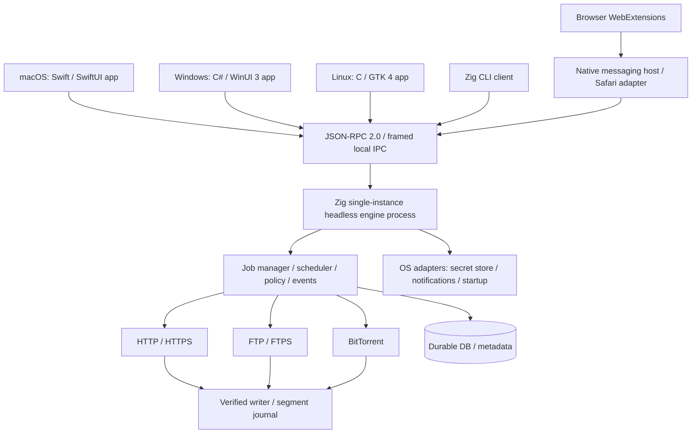

# Speed Download — Project Specification

> **Status:** Proposed / architecture and feasibility phase  
> **Product name:** Speed Download (`speed-download` CLI)
> **Type:** Free, open-source, cross-platform desktop download manager  
> **Core/engine language:** Zig (shared across all platforms)
> **Native GUIs:** macOS Swift / SwiftUI; Windows C# / WinUI 3; Linux C / GTK 4
> **IPC:** JSON-RPC 2.0 over framed, local OS IPC (Windows Named Pipes; macOS/Linux Unix domain sockets)
> **Document version:** 0.2 — 2026-10-12
> **Related:** [Agent.md](Agent.md), [IPC v1](docs/protocols/ipc-v1.md), [ADR 0001](docs/adr/0001-native-guis-local-ipc.md)

## 1. Vision

Build a fast, resilient, privacy-respecting download manager that feels native on macOS, Windows, and Linux while keeping its download engine usable independently of the GUI. The application supports HTTP, HTTPS, FTP, and BitTorrent; intelligently downloads different portions of large files in parallel when supported; resumes safely after failures; and integrates with browsers and operating-system services without intrusive tracking.

**Product principles:**

1. **Correctness before acceleration.** Never sacrifice data integrity to increase speed; do not claim that parallel requests always make downloads faster.
2. **Native where it matters.** Respect each platform's human-interface guidance, accessibility model, notification service, secret storage, startup mechanism, and system tray/menu bar conventions.
3. **One Zig engine, three independent native front ends.** SwiftUI, WinUI 3, GTK 4, the CLI, and browser bridges communicate with the single headless engine over the same versioned, local IPC protocol.
4. **Transparent control.** All interception, auto-start, scheduling, bandwidth rules, and post-download actions are user-configurable and reversible.
5. **Security and privacy by default.** Credentials remain in OS-protected storage; no telemetry or cloud account is required; secrets do not enter logs or persistent download records.
6. **Community maintainability.** Document public APIs, invariants, decisions, platform exceptions, and tests. Keep builds reproducible and source code readable.

## 2. Scope and target support

### 2.1 Architecture matrix

| OS | CPU targets | Native GUI | Core engine | Engineering status / caveat |
|---|---|---|---|---|
| macOS | Intel x86_64; Apple Silicon aarch64 | Swift + SwiftUI / AppKit adapters | Zig | Separate universal (or per-arch) app/engine builds; test sign/notarization, helper launch, IPC, menu-bar and login behavior. |
| Windows | x86 (32-bit i386); x86_64; ARM64 aarch64 | C# + WinUI 3 / Windows App SDK | Zig | Per-architecture .NET/WinUI and Zig artifacts; verify bundled engine lifecycle, named-pipe ACLs, and packaged vs unpackaged deployment. |
| Linux | x86 (32-bit i386); x86_64; ARM64 aarch64 | C + GTK 4 / GLib/GIO | Zig | Match GTK runtime and distro ABI; test X11/Wayland, portals, desktop integration, and installed system libraries. |
| Linux | ARM32 (e.g. armv7) | C + GTK 4, subject to distro support | Zig | Stretch target; engine-first until runtime/CI/hardware support is demonstrated. |

*x86* includes both 32-bit and 64-bit Windows and Linux targets. Modern macOS targets only 64-bit Intel and Apple Silicon; ARM64 is the main ARM target. **A functioning Zig core does not automatically mean that the platform GUI, runtime, installer, or native bridge supports that architecture.** Each advertised configuration must pass real-device installation, accessibility, crash-recovery, and IPC tests.

**Minimum OS/runtime versions remain feasibility decisions**, not commitments. As a starting point, WinUI 3 uses the Windows App SDK and supports Windows 10 version 1809 and later at the framework level; precise app requirements and supported servicing channels must be verified. SwiftUI's macOS deployment target will be selected after validating the UI features used. Record tested versions in `docs/support-matrix.md`.

### 2.2 Native GUI technology decision — mandatory

**Capy UI is removed as a project dependency and is not a release gate.** Its source and Zig version compatibility no longer constrain the Speed Download GUI. Keep the existing Zig CLI/headless core working without any desktop toolkits.

| Platform | Required technology | Language | Responsibility |
|---|---|---|---|
| macOS | SwiftUI; AppKit only where a native capability is missing | Swift | App lifecycle, macOS menus, settings, Finder integration, panels, notifications and accessibility |
| Windows | WinUI 3 + Windows App SDK (XAML); platform APIs as necessary | C# / .NET | Fluent UI, app activation, taskbar/tray, file picker, notifications and accessibility |
| Linux | GTK 4 + GLib/GIO; optional libadwaita when appropriate | C | GTK application lifecycle, file dialogs/portals, desktop notifications, XDG integration and accessibility |
| All | Headless engine/service + CLI | Zig | Transfer protocols, state, persistence, scheduler, bandwidth, download integrity, RPC server and OS IPC transports |

**Hard architecture rules:**

- Each GUI is a **separate native executable/project**. No webview/Electron/Tauri/Capy/Qt/common cross-platform widget layer is used to implement the product GUIs. Reuse the *API schema and design concepts*, not UI view code.
- GUIs never link to the Zig download engine in-process, invoke its internal functions directly, maintain their own download workers, or write the engine's state database. All operational commands and observable download state go through IPC.
- The Zig core must compile, test, and operate as a headless daemon and CLI independent of any GUI or installed UI framework.
- Native platform helpers are allowed for OS facilities (e.g., keychain access, status-bar items, notifications, activation). They must obey the IPC/API boundary, avoid duplicating business logic, and be documented.
- A GUI can restart or reconnect to a surviving engine without losing jobs; the engine can run without the GUI, including after windows close if configured.
- Pin and independently test the exact **Zig toolchain**, **Xcode/Swift**, **.NET + Windows App SDK**, and **GTK/GLib** versions in CI. Do not impose the GUI's language/toolchain on the core.

### 2.3 IPC architecture decision — hard release gate

Adopt **JSON-RPC 2.0 using UTF-8 JSON, framed by a 4-byte unsigned little-endian payload length**, over secure **local, bidirectional stream transports**:

- **Windows:** per-user **Named Pipe** in byte-stream mode; use explicit user/logon-session scoped access control and reject remote connections.
- **macOS:** per-user filesystem **AF_UNIX stream socket** with a short, private runtime path; verify peer identity with `getpeereid`.
- **Linux:** **AF_UNIX stream socket**, normally under `$XDG_RUNTIME_DIR/speed-download/`; verify peer identity with `SO_PEERCRED`.

All clients (Swift, C#, C, Zig CLI, native-messaging bridge) use the **same application protocol**. The platform transport is intentionally different so its security and client APIs are idiomatic and reliable. Do **not** open unauthenticated TCP, HTTP, or WebSocket listeners on localhost as the default desktop control channel. No gRPC/HTTP2 runtime or generated C++/Java bindings are necessary for this use case.

The formal normative contract lives in `docs/protocols/ipc-v1.md`, and the decision is recorded in `docs/adr/0001-native-guis-local-ipc.md`. The first native-UI feasibility spike must prove a one-engine/two-clients request, progress subscription, reconnect, lifecycle, and credential/permission scenario on each OS.

## 3. Users and primary workflows

**Typical users:** people who download large files, work on unstable networks, want scheduled/off-peak transfers, manage many URLs, use torrents, or need downloads to continue while the main window is closed.

**Core journeys:**

1. Paste a URL → preview safe file details, destination, and transfer method → add and start → monitor speed and individual segments → verify and open folder.
2. Click a download in a browser → explicitly offer **Download with Speed Download** → securely hand off to installed app → maintain progress even when the browser closes.
3. Import a `.torrent` file or `magnet:` URL → select files/destination → download with piece validation and optional seeding policy.
4. Set schedules and bandwidth caps → queue jobs → apply rules while running headlessly at login.
5. Pause/resume/restart the app or recover from power loss → reuse only bytes proven to match the same remote representation.

## 4. Functional requirements

Priority labels: **P0 = release-blocking core**, **P1 = first complete release**, **P2 = later enhancement**. Status must be tracked in issues rather than inferred from this specification.

### 4.1 Download management

| ID | Priority | Requirement | Acceptance criteria |
|---|---|---|---|
| DL-01 | P0 | Add HTTP/HTTPS URL manually, drag/drop, paste; editable destination/name | Valid URL creates persisted job; unsafe or invalid URI yields actionable error. |
| DL-02 | P0 | HTTP/HTTPS transfers, redirects, TLS verification, resume | Survives interruption and verifies byte count and representation identity. |
| DL-03 | P0 | Pause, resume, cancel, retry, reorder, delete, reveal file | Defined state transitions; no stale workers or unexpected file deletion. |
| DL-04 | P0 | Queue with global and per-host concurrency | Caps observed in multi-job load tests; fair scheduling avoids starvation. |
| DL-05 | P0 | Crash-safe metadata + incomplete file handling | Restart reconstructs job and does not mark unverified bytes complete. |
| DL-06 | P0 | Dynamic multipart HTTP(S) when permitted | No overlapping writable segments; fallback works with non-range servers. |
| DL-07 | P1 | FTP downloads; FTPS where practical | Passive-mode transfers, size probing, documented resume limitations, TLS for FTPS. |
| DL-08 | P1 | `.torrent` and `magnet:` via BitTorrent | Peer data verified against metadata/piece hashes, file selection and resume. |
| DL-09 | P1 | Queue/history search, filters, sort, grouping and batch operations | Works for large lists without freezing interface. |
| DL-10 | P1 | Checksum entry/import, verify on completion | Mismatches are flagged; no false success notification. |
| DL-11 | P2 | Mirror URLs, download categories, export/import job list | Import handles invalid input gracefully; paths and secrets sanitized. |

**Transfer states:** `queued`, `scheduled`, `resolving`, `connecting`, `downloading`, `paused`, `retry_wait`, `verifying`, `completed`, `failed`, `canceled`. `stopping` and `finalizing` may be internal transient states. Document transition permissions and idempotency in `docs/download-state-machine.md`. A *stop* means a resumable pause unless the user explicitly selects **Cancel / delete partial data**.

### 4.2 Intelligent HTTP/HTTPS multipart engine (IDM-inspired)

Adopt the **concept** of Internet Download Manager's [dynamic segmentation](https://internet.internetdownloadmanager.com/support/segmentation.html), not its code or interface artwork. IDM describes splitting a large remaining segment when an additional connection becomes available and reusing working connections. Develop an independently implemented scheduling algorithm.

**Feature expectations**

- Preflight using `HEAD` where useful; fall back to a minimal `GET`/range probe when HEAD is missing or misleading. Honor redirects, auth challenges, rate limits, and response headers.
- Allow parallel byte-range requests **only after actual behavior verifies support**: correct `206 Partial Content`, `Content-Range`, stable total size / validators, and compatible representation. `Accept-Ranges` alone is a hint, not proof.
- Send `Accept-Encoding: identity` where appropriate for raw range correctness; reject or safely fall back from transparently transformed/compressed representations.
- Use an interval/range allocator: all bytes are either **not assigned**, **in progress**, or **durably completed**; never allow overlapping writes that race. Use bounded segment subdivision. For a newly free worker, split a sufficiently large uncompleted portion of the largest active range (approximately in half), assign its tail, and let the existing worker retain its current cursor. Never split below a configurable safe threshold.
- **Reuse live connections when the networking backend/protocol allows.** Do not promise reuse across incompatible hosts, schemes, or auth contexts, or across separate non-reusable transports. Reallocate work to idle workers when possible.
- User preferences: mode `off | auto | fixed`, default **auto**; suggested default max connections per file **8** with configurable 1–32 (actual caps depend on server/OS), minimum split size default **4 MiB**, global and per-host connection caps, retry/backoff limits, and optional conservative mode. All defaults are proposals to benchmark, not performance guarantees.
- Adaptive mode may reduce connection count on throttling (`429`, `503`, `Retry-After`), repeated `403`, high error rate, or low marginal throughput. Respect server policy and avoid aggressive retries.
- On `200` in place of expected `206`, inconsistent `Content-Range`, unexpected `416`, changed size, `ETag`/`Last-Modified` mismatch, or content transformations: stop relevant workers, quarantine/discard invalid partial bytes, and safely restart or ask the user. **Never concatenate incompatible versions.** `If-Range` should be used with appropriate validators.
- For unknown-length, streaming, or non-seekable resources, download sequentially unless the protocol provides a correct alternative.
- Persist a versioned segment journal and sync checkpoints; use random-access writes (`pwrite`-style or equivalent), a `.part` file, atomic metadata updates, and a safe final rename once validated. Crash recovery may roll back uncertain extents rather than trust unflushed progress.
- Schedule disk writes with bounded buffers and backpressure; memory cost must not increase without limit as connections increase.
- Show **both aggregate progress and the map of ranges** in the UI, including the reason multipart is unavailable.

**Segment model example (conceptual):** for a 1 GiB object, begin with one active worker. As more connections become available, assign distinct outstanding subranges without redownloading completed bytes. Workers update durable contiguous cursors. When the remaining work shrinks, dynamically reassign large residual subranges to available workers. Piecewise progress must remain monotonic for valid completed bytes, but may regress when server content changes and a restart is required.

**HTTP tests (must be automated):** no `Accept-Ranges`, lying range support, `200` fallback, `206` with wrong offsets, `416`, weak/strong ETags, resource change while downloading, unknown content length, chunked transfer, gzip, redirect cycles, proxy/auth, TLS failure, timeouts, throttling, transient disconnects, sparse files, out-of-space, interrupted journal writes, and 32-bit large-file handling. Conform to [RFC 9110 range semantics](https://www.rfc-editor.org/rfc/rfc9110.html).

### 4.3 FTP/FTPS

- Support `ftp://`; add `ftps://` (explicit/implicit behavior documented by backend) as P1 security improvement; warn about clear-text FTP credentials and data channels.
- Use passive/EPSV as appropriate, TLS certificate validation for FTPS, sensible connection/retry timeouts, size (`SIZE`) and restart (`REST`) only when server actually supports them.
- Filename encoding, IPv4/IPv6, NAT, directory listings if implemented, and authentication failure behavior need integration tests.
- Do **not** assume FTP has safe independent multipart ranges. Initially use a single transfer plus resumability; only implement FTP parallelization after a documented capability and correctness study.

### 4.4 BitTorrent

- Accept `.torrent` and `magnet:` (metadata exchange), select files and priority, show peer/seed counts when available, verify pieces, safely resume, and offer seeding controls.
- Support necessary tracker/peer operations and magnet metadata acquisition; evaluate DHT, PEX, encryption compatibility, IPv6, UDP trackers, uTP, and v2 torrents as separately tracked capabilities. A library/engine choice requires license, ABI, cross-platform, and supply-chain review.
- Pieces/blocks are **not HTTP byte-range segments**. Share queue/persistence/status abstractions and bandwidth controls, but keep protocol-specific strategy and verification separate.
- Separate **download cap** and **upload cap**, report both, and document that BitTorrent normally uploads during fetching. Post-completion seeding is optional/configurable; do not silently expose private downloaded files.
- For torrents, validate all metadata, path nesting, names, symlinks, total size, file count, and path traversal. Never write outside the user-approved destination.

### 4.5 Scheduling and bandwidth

| ID | Priority | Requirement | Acceptance criteria |
|---|---|---|---|
| SC-01 | P1 | Start or pause jobs at user-selected clock times | Fires correctly across sleep/wake, timezone changes, and DST transitions. |
| SC-02 | P1 | One-time and recurring schedules | User can select days, start/end windows, and priority per queue/job. |
| SC-03 | P1 | Bandwidth cap global/per-job, optionally per-protocol | Observed aggregate rate stays near configured cap over meaningful windows. |
| SC-04 | P1 | Time-window bandwidth profiles | For example daytime 2 MiB/s, night unlimited; applied without restart. |
| SC-05 | P1 | Pause/restart behavior for missed events | Missed start after wake executes if window remains open; expired window stays paused. |
| SC-06 | P2 | Optional network/battery/metered constraints | Policy is explained and user-overridable. |

Use a shared **token-bucket limiter** with monotonic clocks and aggregate accounting, plus fair per-job distribution; separately account for BitTorrent upload and download. Display units explicitly (`MB/s` versus `MiB/s`; `Mb/s` versus `MB/s`). Express recurrence in a named time zone, define daylight saving ambiguity and missed-event behavior, and prevent duplicate triggers on clock adjustments. Schedule policies must work without the GUI.

### 4.6 UI/UX — minimal, informative, and platform native

**Aesthetic:** restrained typography, comfortable spacing, neutral surfaces, system accent color, clear focus rings, no unnecessary animation, accessible contrast, optional reduced motion. Support `system / light / dark` themes; do not simulate native title bars when proper native controls are available.

**Core views:**

1. **Downloads:** queue/list of file name, file type, source, status, size, progress, speed, ETA, destination/category; toolbar **Add**, **Pause/Resume**, **Retry**, **Schedule**, **Preferences**, search/filter.
2. **Download details:** timeline/activity, connection/range map, transfer health, headers/source metadata (safe view), logs with secrets redacted, optional checksum and file operations.
3. **Schedule:** calendar/time-window editor, bandwidth profiles, preview of upcoming behavior, conflicts and active rules.
4. **Preferences:** General, Downloads, Connections & Segments, Bandwidth, Schedule, Browser Integration, Privacy & Credentials, Notifications, Appearance, Advanced.
5. **Torrent details:** files tree, per-file progress, pieces (optional), peers/trackers, seeds, upload/seeding limits.

**Elegant multipart visualization:**

- Primary progress bar communicates **overall verified progress**, not a count of connections.
- Secondary thin segmented timeline spans the file from offset 0 to total size and distinguishes **completed**, **active**, **pending**, and **failed/retry** ranges by color **and** pattern/tooltips/accessible labels. Indicate the number of active connections and per-connection speed in a collapsible panel; do not overload the default view.
- A hover/focus segment detail shows offset range, downloaded bytes, worker ID, recent rate and retry state. Enable keyboard and screen-reader equivalent summaries; offer a simple progress-only fallback.
- Avoid color-only distinctions and high-frequency repainting. Throttle UI updates (e.g., 5–10 Hz under load), separately from internal engine updates; prevent the UI from blocking on disk/network operations.

**Platform-native implementations:**

| Platform | HIG / conventions | Implementation expectations |
|---|---|---|
| macOS | [Apple macOS HIG](https://developer.apple.com/design/human-interface-guidelines/designing-for-macos/) | SwiftUI `WindowGroup`/settings/views, true system menus, keyboard shortcuts, native open/save panels, accessibility, and AppKit integrations only as needed (Dock/menu-bar/status item, advanced table behavior). |
| Windows | [Windows/Fluent design](https://learn.microsoft.com/en-us/windows/apps/design/) | C# WinUI 3 XAML views, `NavigationView` or equivalent native patterns, Windows App SDK, taskbar/notification area, scalable DPI, system colors, native activation and accessibility. |
| Linux | [GNOME HIG](https://developer.gnome.org/hig/) as a baseline with other desktops respected | GTK 4 / GLib application with `GtkColumnView`/models where appropriate, GTK native file dialogs or portals, XDG paths, keyboard access, theme preference and desktop notifications. |

The **multipart segment map** is a small platform-native custom drawing control (SwiftUI `Canvas`/accessibility equivalent, WinUI 3 `Canvas`/Composition/custom control as validated, GTK 4 `GtkDrawingArea` or snapshot custom widget). It consumes identical segment data but is implemented and accessible separately on each OS. Shared business logic must remain in Zig, not copied into three view models.

**Linux caveat:** notification-area/tray support varies by GNOME/KDE/Xfce and Wayland; where unavailable, background jobs must be recoverable through the launcher, notification, and CLI. `libadwaita` may be adopted for GNOME style but cannot be a silent hard dependency if it prevents other supported desktops or CPU architectures from working.

### 4.7 Browser extensions and integration

**Target browsers:** Google Chrome, Microsoft Edge, Mozilla Firefox, Safari (macOS), Brave, Opera, Vivaldi. Chromium-derived browsers may share most extension code but require separate packaging/QA and potentially separate native host allowlists.

- Browser extension code must be WebExtensions-compatible **JavaScript/TypeScript**, with minimal vendor-specific glue. **Zig-only** applies to the shared download engine and core CLI; native desktop GUIs intentionally use Swift, C#, and C, while browser extensions use JS/TypeScript.
- Functions: context-menu **Download with Speed Download**, optional integration with the browser download API, URL handoff with user confirmation, add-from-current-tab when authorized, extension settings, per-site enable/disable, and installed-app status.
- Never claim all downloads can be intercepted: browser API/security/sandbox restrictions, streaming media, DRM, authentication-bound requests, blob/object URLs, and `POST` transfers may prevent handoff. Avoid promising DRM bypass or media extraction.
- Use **native messaging** for Chromium and Firefox (with host manifest per OS/browser). The trusted native host is a minimal, separately scoped adapter that validates/authorizes browser messages and forwards only approved operations to the same engine IPC server. Native messaging `stdin/stdout` framing and access policy remain distinct from the engine IPC transport. An extension service worker reconnects as needed; do not open an unauthenticated localhost TCP listener.
- Safari uses an **Xcode-packaged Safari Web Extension** attached to the SwiftUI containing app and a native Safari bridge. Its entitlement/app-group/signing design must be reviewed; the bridge routes permitted actions to the same engine IPC, not directly to internal Zig APIs. Safari is not simply the Chromium extension binary copied onto macOS.
- Version, validate, size-limit, and authenticate/authorize IPC messages. Maintain strict allowed extension IDs/origins, explicit user intent, least privileges, origin-aware handoff, and redaction of cookies/authorization headers. Do not pass browser session cookies by default.
- Persist jobs in the daemon **before** acknowledging the browser handoff, and deduplicate retries using request IDs; handle native-host crash and service-worker sleep.
- Keep separate extension store release checklists; permissions and manifests can differ across browsers.

**Security note:** URL handoff is not permission to read arbitrary local files, use ambient OS credentials, or execute commands. The bridge has no general shell-command API.

### 4.8 Headless, startup, tray, and notifications

- Expose one **single-instance per-user Zig engine process** that survives GUI restarts, runs without graphical windows, and exposes the authenticated local IPC endpoint. Every GUI/CLI client attaches independently. Closing a window follows preferences (`quit GUI`, `hide when supported`, `leave engine running`, or `stop engine`) and gives confirmation when ambiguous. Do not stop the engine merely because a UI connection is lost.
- Settings: **Launch on login**, **Start minimized**, **Run engine in background**, **Minimize to tray / menu-bar/status area when supported**, and **Launch GUI when manually invoked**. Each is an independent explicit preference.
- Distinguish desktop login startup from **system service at boot**. Service-before-login is optional, platform-specific, carefully permissioned, and not enabled by default.
- Provide native OS completion/failure notifications with per-category toggles and clickable actions where supported. Do not show credentials, private source query strings, or sensitive file paths in lock-screen notifications.
- Platform mechanisms (evaluate during spike): macOS login item / LaunchAgent plus SwiftUI/AppKit notification helper; Windows per-user task/startup and Windows App SDK notification integration; Linux systemd user service or XDG autostart plus GTK/GIO/Freedesktop/portal notifications. GUI and engine use independently managed process lifecycles; avoid automatically configuring a privileged system-wide service.
- Keep headless CLI useful: `speed-download add <url>`, `speed-download list`, `speed-download pause <id>`, `speed-download resume <id>`, `speed-download status`, `speed-download daemon` (proposed; finalize in CLI design). CLI should share application commands and validation with GUI.

### 4.9 Credentials and privacy

- Save site credentials, optional proxy credentials, and certificate-related secrets using **OS-provided secret stores**, never plaintext config, logs, shell arguments, or the job database. The Zig engine/platform-services layer controls durable credential references; GUIs send approved changes over IPC and must not leak secrets into snapshots or progress events.
- macOS: **Keychain Services**; Windows: **Windows Credential Manager / DPAPI-backed per-user credential storage**; Linux: **Secret Service API (libsecret / compatible keyring)**. Detect missing/locked Linux keyring and offer session-only use or clear error, **not silent plaintext fallback**.
- Maintain records by protocol, normalized host, realm/account, port and optional path scope. Support add/view metadata, update, remove; password reveal requires explicit OS-backed authorization where practical. Never assume credentials for one origin should be sent after cross-origin redirects.
- Browser handoff should transfer URL and safe metadata only by default. If authenticated downloads need cookie/header forwarding, implement a narrowly scoped, ephemeral, consent-driven flow with high scrutiny; never bulk-import browser passwords.
- Logging: URL query strings and headers may contain bearer tokens; redact by default. Use structured logs with opt-in diagnostic verbosity and secure export.
- No analytics/telemetry by default. Any optional crash reporting requires an explicit opt-in, documented privacy policy, and secret scrubbing.

## 5. Architecture

### 5.1 Process and ownership architecture



**Process separation and boundary rules:**

- `engine` is the authoritative owner of transfer workers, jobs, settings, scheduler, queued state, persistence, and download files. It is a **separate Zig process**, not a linked DLL/dylib, framework, or dynamic library embedded in any GUI.
- `ipc` is a documented JSON-RPC application protocol with OS-specific local transports; it carries commands, snapshot results, and optional streamed event notifications. Messages are validated before entering core services.
- Each `gui/*` implements only local presentation, interaction, OS integrations, and a typed RPC client: **SwiftUI in Swift**, **WinUI 3 in C#**, and **GTK 4 in C**. Views must never block waiting for synchronous engine I/O on the UI thread.
- `cli` uses the **same RPC endpoint** for interactive commands; only the `daemon` command starts the engine and hosts the endpoint. Shared Zig modules may define types internally, but the CLI is not a privileged backdoor to core state.
- Transfer drivers implement documented operations: `probe`, `start`, `pause`, `cancel`, `resume`, `progress`, `verify`, `cleanup`; BitTorrent may implement seeding/upload extensions.
- `storage` owns atomic journals/files; SQLite remains a **candidate** pending Zig FFI/binding, WAL, recovery, licensing and target-arch review.
- `platform` in the engine defines trusted OS service adapters for secret storage, launcher/autostart, paths, and notification orchestration. Platform-specific GUI code implements OS-facing window/dialog/status-area details. Do not require a GUI process just to save a progress checkpoint or execute a schedule.
- `extensions` is packaged separately: a browser cannot talk to the privileged engine API directly. Its native messaging host implements a **restricted allowlist** and delegates to IPC after validation.
- Multiple UI clients and the CLI can connect concurrently. Commands use stable identifiers, idempotency keys where needed, and expected-state revisions; UI cache never overwrites authoritative engine state.

### 5.2 Suggested repository layout (proposed, not implemented)

```text
.
├── Agent.md                         # Update agent guidance to match this ADR
├── PROJECT.md                       # Project specification
├── README.md
├── LICENSE
├── build.zig                        # Zig engine + CLI + common Zig tests only
├── build.zig.zon                    # Pinned Zig dependencies
├── src/
│   ├── daemon/main.zig              # Single-instance headless engine entry point
│   ├── cli/main.zig                 # Zig CLI acting as RPC client
│   ├── core/                        # Jobs, queue, scheduling, policy, events
│   ├── protocols/{http,ftp,torrent}/
│   ├── storage/                     # DB, crash-safe journals, file writer
│   ├── ipc/                         # JSON-RPC, framing, schema, endpoint and clients
│   ├── platform/{macos,windows,linux}/ # Zig OS-specific daemon adapters
│   └── util/                        # Checked math, units, redaction
├── gui/
│   ├── macos/                       # Xcode project: Swift + SwiftUI + AppKit glue
│   ├── windows/                     # .sln/.csproj: C# + WinUI 3 + Windows App SDK
│   └── linux/                       # Meson: C + GTK 4 + GLib/GIO
├── ipc-schema/                      # Shared protocol JSON schemas + fixtures
├── extensions/
│   ├── common/                      # TypeScript WebExtension implementation
│   ├── chromium/                    # Chromium browser variants
│   ├── firefox/
│   ├── safari/                      # Swift/Xcode native Safari bridge
│   └── native-host/                 # Narrowly scoped browser-to-engine IPC bridge
├── tests/{unit,integration,ipc,e2e,fixtures}/
├── docs/
│   ├── architecture/
│   ├── adr/0001-native-guis-local-ipc.md
│   ├── protocols/ipc-v1.md
│   ├── design/
│   ├── security/
│   └── platforms/
├── packaging/{macos,windows,linux}/
└── .github/workflows/              # Separate engine + native GUI CI per OS/arch
```

The repository structure is a design proposal, not a claim that these files exist. macOS apps build with Xcode, Windows with MSBuild/.NET and Windows App SDK, Linux with Meson/pkg-config/GTK 4, while Zig manages only the engine and CLI. The release pipeline assembles **one native GUI plus the matching engine and IPC bridge(s)** per platform/CPU architecture. The presence of three GUIs does not mean every release must build all three on one host.

### 5.3 Persistence / file integrity model

- Store jobs, settings (without secrets), event/checkpoint metadata, scheduler policy, transfer representation validators, and per-range cursors in versioned durable storage.
- Use an incomplete-file extension and a stable job-specific ID. The final path must be chosen by the user or a predictable collision policy; renames happen only after verification and successful durable flush. Avoid replacing an existing completed file silently.
- Journal the mapping between remote representation identity, allocated intervals, and flushed bytes; invalidate questionable ranges after crash. Disk operations on 32-bit builds require 64-bit safe offsets and carefully audited casts.
- Resume an HTTP object only if source identity remains trustworthy. Weak metadata may require revalidation or restarting; never treat an arbitrary URL as immutable.
- Download history can be cleared independently of deleting completed files; application uninstall must not erase user downloads.

### 5.4 Event/API model

The server implements **JSON-RPC 2.0** (not an ad hoc JSON command format). Recommended names: `engine.hello`, `engine.status`, `jobs.add`, `jobs.list`, `jobs.get`, `jobs.start`, `jobs.pause`, `jobs.resume`, `jobs.cancel`, `jobs.retry`, `jobs.subscribe`, `jobs.unsubscribe`, `settings.get`, `settings.update`, `schedule.set`, `torrents.selectFiles`. Finalize method contracts before implementation in `docs/protocols/ipc-v1.md`.

**Requests** have JSON-RPC `id`, `method`, and `params`; requests requiring changes also carry a stable `idempotency_key` and optionally `expected_revision`. **Responses** contain `result` or structured `error`. **Progress/events** are JSON-RPC notifications from server to client with no `id`; clients must not expect a reply to notifications. A GUI should subscribe on a long-lived duplex connection, not poll every job at high frequency.

- `engine.hello` is required before any other application RPC. Negotiate protocol **major/minor versions**, client type, supported features, and engine instance identifier. Reject incompatible major versions gracefully; tolerate only explicitly documented backwards-compatible changes.
- Use **4-byte little-endian unsigned length + exactly that many UTF-8 JSON bytes** per frame (not newline-delimited JSON). Maximum frame length: **1 MiB initially**; enforce configurable smaller limits where appropriate; reject zero-length, malformed UTF-8/JSON, giant arrays, and excessive nesting. `read`/`write` can be partial.
- Define all logical `uint64` counters, byte offsets, and sizes as **base-10 decimal strings** in JSON to avoid precision loss in JavaScript/native bridges. Never send local integer pointers or OS handles as values. Define timestamps as ISO 8601 strings with UTC offset and speeds as appropriately named units.
- Subscribing returns a consistent **initial snapshot + cursor** (atomic relationship), then ordered `events.changed` notifications with monotonically increasing sequence numbers. Slow clients receive coalesced progress; missed sequence or engine-instance change forces a re-snapshot. Download progress visualization should generally refresh at 5–10 Hz or slower under load.
- Keep command replies and subscriptions independent so a slow window cannot block or stall core workers. Bound per-client outgoing buffers; disconnect/resync a client when necessary. No loss of authoritative job state is allowed.
- Each accepted mutation is persisted when necessary **before acknowledging success**. Use request IDs for matching RPC responses and idempotency keys for safe retries after a broken connection (these are distinct concepts). Client disconnect/retry must not create duplicate downloads.
- Canonical jobs/settings/status definitions live in a shared, version-controlled `ipc-schema/` with golden fixtures and examples usable from Swift, C#, C, Zig and TypeScript tests.

### 5.5 Platform IPC endpoints and security

| OS | Transport and example location | Required guardrails |
|---|---|---|
| Windows | Byte-mode Named Pipe at a deterministic, collision-resistant per-user/session name, e.g. `\\.\pipe\SpeedDownload-<user-scope>` (illustrative) | Explicit DACL restricted to intended user/logon scope and required service principals only; `PIPE_REJECT_REMOTE_CLIENTS`, no generic Everyone/anonymous access; protect against pipe squatting and cross-session collisions. |
| macOS | AF_UNIX SOCK_STREAM at a **short per-user runtime path**, secured within an owned mode-0700 directory | `getpeereid` UID validation; mode-0600 socket where supported; protect against symlink/path replacement; obey `sun_path` length limit. |
| Linux | AF_UNIX SOCK_STREAM at `$XDG_RUNTIME_DIR/speed-download/engine.sock` | Private mode-0700 directory, mode-0600 socket, validate `SO_PEERCRED` UID; fail safely or use a strictly verified private runtime directory if XDG runtime is unavailable. |

For every OS: scope the daemon to the current interactive account, enforce one engine per profile, verify the endpoint owner and server identity where supported, use safe ownership-aware stale-endpoint cleanup, and launch **only the signed/installed engine at a trusted absolute path**. An OS-local pipe is **not** a security boundary against malware running as the same user; don't overpromise. No inherited privileged server identity, network exposure, arbitrary file read/write RPC, generic command execution, or silent elevation. Permission grants and sensitive operations require specific, audited methods with constrained paths and user intent.

### 5.6 Engine lifecycle, discovery and failure handling

- A GUI starts by attempting to connect to the configured endpoint. If no engine is running, launch the installed matching Zig daemon **as that user**, await readiness with a bounded timeout, and reconnect. Handle simultaneous UI/CLI launches via OS process lock/single-instance semantics; never spawn multiple competing engines.
- Login/background startup manages only the daemon if configured. The GUI can launch later, close, crash, or upgrade independently of active transfers. If the engine stops, GUIs render a disconnected state and offer safe restart/reconnect; do not display stale progress as live.
- Do not silently terminate ongoing downloads on GUI exit. An explicit **Quit and stop engine** action checks active jobs and uses a graceful stop policy; upgrading binaries preserves verified checkpoints and handles active transfers safely.
- Discover endpoint via fixed safe per-user rules, not untrusted environment/URL input. A browser native-host process may wake the engine only through the same trusted installation and lifecycle path.
- On reconnect, renegotiate `engine.hello`, get a fresh snapshot/subscription, reconcile revisions/cursor, and reissue only operations with durable idempotency keys. Run engine versions and GUI versions through an explicit backwards-compatibility matrix.

### 5.7 Browser-facing boundary

Chrome/Firefox/Chromium native messaging uses its browser-defined native host contract, and Safari uses Apple app-extension APIs. These are **not** the engine IPC server. The native host must validate extension identity, payload format, origin and explicit user action, and forward only narrowly approved commands (e.g. add eligible URL) to the authenticated local engine. It must not forward arbitrary JSON-RPC method names, filesystem paths, credentials, or privileged method bodies from a web page. Apply rate limits, replay/deduplication keys, and strict redaction. Browser extension output and engine RPC responses use separate schemas and permissions.

### 5.8 Implementation spike / contract acceptance tests

Before committing to full GUI development, demonstrate: engine start from cold, concurrent Swift/C#/C/CLI client connects on their respective OSes, `hello`, add and pause a test download, live event subscription and coalescing, GUI crash and reconnect, engine restart and snapshot reconciliation, oversized/malformed framing, unauthorized local client rejection, application install/uninstall behavior, OS login startup, and at least one packaged Windows WinUI 3 build that can launch/connect to the matching Zig daemon. The engine must continue downloading when all GUIs are closed.

## 6. Quality, performance, accessibility, and security

### 6.1 Proposed measurable targets (validate with baselines)

- **Data integrity:** 100% of successfully reported test downloads match their expected digest or server-validated representation; no mixed-version assembled output.
- **Crash recovery:** a forcibly terminated multipart job restarts as queued/paused and reuses only journal-validated byte ranges; no silent success.
- **Responsiveness:** GUI interactions remain responsive during at least 100 concurrent queued/active jobs on representative hardware; progress refresh does not block UI thread.
- **Scheduling:** test windows for DST forward/backward changes, sleep/resume, manual clock changes, and timezone moves.
- **Bandwidth:** under stable local test conditions a 5-second average should stay within an explicitly tested tolerance around a configured cap; account for buffering/clock granularity.
- **Resource use:** bounded memory per connection and per job, with stress tests for 32-bit targets and large files (greater than 4 GiB on 32-bit processes through 64-bit file APIs).
- **Accessibility:** keyboard-only operation, visible focus, screen-reader labels, color contrast, reduced motion, large text, and non-color-only multipart statuses.
- **Security:** deny arbitrary local file reads through browser IPC, reject path traversal from torrents and URLs, verify certificates, never log secrets, and reject untrusted host commands.

Targets are release gates to measure, not established benchmark claims.

### 6.2 Testing strategy

| Layer | Required coverage |
|---|---|
| Unit | State machine, range allocator/interval invariants, math/overflow, rate limiter, scheduler/DST, URL/origin rules, filename sanitization, redaction. |
| Property / fuzz | Interval split and merge, malformed HTTP headers/content ranges, torrent metadata and paths, native IPC payloads, persistence recovery. |
| Integration | Local controllable HTTP/HTTPS/FTP/BitTorrent fixtures with artificial disconnects, 429/503, redirects, wrong lengths, TLS failures and disk faults. |
| GUI | Independent SwiftUI, WinUI 3, GTK 4 smoke tests: focus/accessibility, HiDPI, theme, native dialogs, lifecycle, status area, reconnect, background handoff. |
| IPC | JSON-RPC 2.0 schema/golden fixtures shared by Zig/Swift/C#/C, framing/parser fuzz tests, peer permission checks, multi-client subscriptions, reconnect/version negotiation, queue backpressure, idempotent mutation retries. |
| Browser | Manifest permission checks, native host registration, service-worker lifecycle, Safari bridge, browser update compatibility, multi-profile and uninstall. |
| Packaging | Clean installation, signing/notarization where applicable, upgrade/migration, uninstall without deleting downloads, per-architecture native execution. |

CI should be stratified: `format + unit` on every PR; cross-platform Zig core builds and IPC contract tests; separate Xcode/macOS, Windows/WinUI, and Linux/GTK GUI pipelines; supported GUI smoke tests on OS runners; release builds on the platform/arch matrix; macOS Apple Silicon, Windows ARM64, and Linux ARM64 on real hardware or a validated runner before labels change to stable. Architecture-specific testing must not be replaced solely with emulation or cross-compilation.

## 7. Distribution and license

- Repository and source are publicly accessible under the **MIT License** for application code. Third-party dependencies retain their own licenses and must be reviewed before adoption. Review Swift/Apple SDK, WinUI 3/Windows App SDK/.NET redistributable terms, GTK 4/GLib (LGPL) dynamic linking/compliance, and BitTorrent engine dependencies. No Capy dependency remains. Document decisions in `docs/licenses.md`, include notices and an SBOM.
- Planned packages: **macOS** native SwiftUI `.app` containing/signing a matching Zig daemon and optional helpers, shipped as notarized `.dmg`/`.pkg`; **Windows** WinUI 3 app + Zig daemon, with MSIX vs packaged-with-external-location vs unpackaged `.msi`/`.exe` decided after lifecycle/IPC and notification testing (portable optional); **Linux** GTK 4 app + Zig daemon with `.deb`, `.rpm`, AppImage and/or Flatpak where portals, runtime dependencies, and background execution work. Ship per-architecture native UI + engine together and verify upgrades cannot orphan running processes. Package availability depends on measured platform and store requirements.
- Browser extensions are separately signed/published where required; Safari needs an Apple app-extension package. Extension permissions are reviewed for each release.
- Never include update or silent-install mechanisms that bypass OS consent; signed update manifests and rollback can be a later milestone.
- Include `README.md`, `CONTRIBUTING.md`, `CODE_OF_CONDUCT.md`, `SECURITY.md`, license and third-party notices before public contribution campaigns.

## 8. Delivery plan and exit gates

| Phase | Deliverables | Exit criteria |
|---|---|---|
| **0 — Native/IPC feasibility** | Zig toolchain pin; per-platform GUI hello-world apps; native IPC demo; shared JSON-RPC schema; endpoint ACL/permissions; ADR; distribution feasibility | WinUI 3, SwiftUI, GTK 4 each connect to separate Zig engine build on their OS, show live test progress, reconnect; all GUI targets labeled verified/experimental/blocked. |
| **1 — Core MVP** | Headless Zig daemon and RPC CLI; HTTP/HTTPS single-stream; queue/state DB; safe resume; file writes; unit/integration suite | Reliable headless transfers and restart persistence; GUI not required. |
| **2 — Acceleration** | Dynamic byte ranges, per-host fairness, retry/backoff, segment journal, limiter, IPC progress subscriptions | Adversarial validators pass, no overlapping writes; multiple UI/CLI clients can't stall core. |
| **3 — Native desktop UIs** | Independently built SwiftUI/macOS, WinUI 3/Windows, GTK 4/Linux download list, details, segment timeline, preferences, accessibility | Each GUI passes native HIG, IPC, install, restart and platform smoke tests on declared architectures. |
| **4 — Protocols & automation** | FTP/FTPS, BitTorrent, scheduler, bandwidth profiles, platform secret-store adapters | Cross-protocol integrity, time-window scheduling and secrets tests pass without GUI open. |
| **5 — Integrations** | Chromium/Firefox bridges, Safari bridge, OS startup/tray/notifications, IPC security audit | Native host only exposes allowed browser actions; each OS/browser can safely hand off and recover after restart. |
| **6 — Multiarch and distribution** | macOS universal builds/notarization, Windows x86/x64/ARM64 WinUI packages, Linux multiarch GTK packages, migration/upgrade tests | Every advertised combination passes on real hardware or fully validated equivalent; no Capy-related target gate. |
| **7 — Stable 1.0** | Security, IPC fuzz, HIG/accessibility, performance, docs, versioned protocol compatibility | Source/installer/checksum/license notices published; no unresolved P0 issues. |

Phases can overlap, but **do not label 1.0 cross-platform until phase-6 release gates pass**. Early previews must list verified platforms and CPU architectures. Update `Agent.md` and the architecture ADR before a coding agent resumes GUI changes.

## 9. Risks and decisions still open

| Risk / question | Mitigation / decision owner |
|---|---|
| Multiple native GUI codebases increase maintenance | Keep business logic inside Zig; share protocol contracts, UI flows, assets, accessibility acceptance criteria, and fixtures. |
| WinUI 3 Windows ARM64/x86 deployment and packaged process model | Verify .NET/Windows App SDK version, runtime architecture, app activation, bundled daemon and pipe ACL on hardware in phase 0. |
| macOS SwiftUI feature availability, notarization and helper execution | Set supported macOS baseline after SwiftUI feature spike; sign/notarize engine and helpers in app bundle; validate LaunchAgent/login behavior. |
| GTK 4/Linux ARM32 and distro availability | Track distro/ABI/GTK dependencies separately; keep ARM32 engine-first until native GUI and installer run on hardware. |
| IPC format, schema drift, backward compatibility | Versioned JSON-RPC 2.0 + framed transport, golden fixtures across four languages, compatibility tests and explicit major/minor negotiation. |
| Named Pipe / Unix socket hijacking and local privilege misuse | Private per-user endpoint, explicit pipe DACL, Linux SO_PEERCRED / macOS getpeereid, no remote listener, safe process launch and least-privileged RPC API. |
| Too many progress events freeze native UI or daemon | Bounded subscriptions, updates coalesced to 5–10 Hz, snapshot + cursor protocol, no blocking on UI threads. |
| Browser native messaging becomes a general RPC tunnel | Keep browser host on a small allowlist; validate origin/user intent; never expose unrestricted RPC or secrets to web content. |
| Zig toolchain and native toolchain versions diverge | Independently pin Zig, Xcode/Swift, .NET/Windows App SDK, GTK/GLib and integrate only over backwards-compatible IPC. |
| Performance of multiple connections is server dependent | Benchmark single-stream vs multipart, safe fallback, adaptive caps; never promise speedups. |
| BitTorrent protocol complexity, license, and security | Evaluate maintained engines/FFI vs Zig implementation by license, ABI, multiarch and tests. |
| OS credential store availability and headless auth prompts | Separate daemon storage APIs from native GUI consent/credential entry; never fall back to plaintext. |
| Background/tray behavior differs across Linux desktops | Explicit desktop matrix; recoverable daemon from launcher/notification/CLI. |
| Architecture-specific large-file and ABI problems | Checked 64-bit offsets, file I/O and CLI/GUI/IPC tests on 32-bit Windows/Linux. |
| Licensing and third-party notices | Review .NET/Windows App SDK redistribution and LGPL libraries, SBOM, open-source notices. |

## 10. Definition of release readiness

A release is ready only when its **separate native GUI and Zig engine** both compile, run, install, securely connect through IPC, and pass their specified smoke/integration tests on every advertised platform/architecture; the download engine does not corrupt files under network faults; credential storage is OS-backed; no feature claims exceed tested behavior; accessible alternatives exist for essential UI controls; user documentation explains permissions/limitations; and build, source, third-party notices, checksums, and release notes are published.

**The first engineering action** should be phase 0: a running Zig daemon with framed JSON-RPC 2.0 and one small native GUI client per OS (SwiftUI, WinUI 3, GTK 4), in parallel with independently tested HTTP downloads. Preserve working CLI/core builds. Do not design full UIs against an untested IPC, process startup or packaging model.

## 11. Technical references

These are normative background/verification links, not copied source code:

- [Zig releases and target downloads](https://ziglang.org/download/)
- [WinUI 3 / Windows App SDK](https://learn.microsoft.com/en-us/windows/apps/winui/winui3/)
- [Windows app packaging and deployment](https://learn.microsoft.com/en-us/windows/apps/package-and-deploy/packaging/)
- [Named pipes: security and access rights](https://learn.microsoft.com/en-us/windows/win32/ipc/named-pipe-security-and-access-rights)
- [Apple SwiftUI documentation](https://developer.apple.com/documentation/swiftui/)
- [Apple silicon universal Mac apps](https://developer.apple.com/documentation/apple-silicon/porting-your-macos-apps-to-apple-silicon)
- [Apple `getpeereid` reference](https://developer.apple.com/library/archive/documentation/System/Conceptual/ManPages_iPhoneOS/man3/getpeereid.3.html)
- [GTK 4 API documentation](https://docs.gtk.org/gtk4/)
- [Linux `unix(7)` and `SO_PEERCRED`](https://man7.org/linux/man-pages/man7/unix.7.html)
- [JSON-RPC 2.0 specification](https://www.jsonrpc.org/specification)
- [IDM dynamic segmentation explanation](https://internet.internetdownloadmanager.com/support/segmentation.html) — behavioral inspiration only
- [RFC 9110 — HTTP Semantics and Range](https://www.rfc-editor.org/rfc/rfc9110.html)
- [BitTorrent BEP 3](https://www.bittorrent.org/beps/bep_0003.html) and [BEP 9 metadata exchange](https://www.bittorrent.org/beps/bep_0009.html)
- [Chrome native messaging](https://developer.chrome.com/docs/extensions/develop/concepts/native-messaging)
- [Mozilla native messaging](https://developer.mozilla.org/en-US/docs/Mozilla/Add-ons/WebExtensions/Native_messaging)
- [Apple Safari web extensions](https://developer.apple.com/documentation/safariservices/safari-web-extensions)
- [Apple Safari messaging](https://developer.apple.com/documentation/safariservices/messaging-between-the-app-and-javascript-in-a-safari-web-extension)
- [Apple macOS HIG](https://developer.apple.com/design/human-interface-guidelines/designing-for-macos/)
- [Microsoft Windows design guidance](https://learn.microsoft.com/en-us/windows/apps/design/)
- [GNOME HIG](https://developer.gnome.org/hig/)
- [Apple 32-bit macOS compatibility notice](https://support.apple.com/en-ie/103076)

**Maintenance rule:** Re-check upstream documentation, toolchain compatibility, browser extension policies, and OS APIs before each major architecture or release decision. Any divergence must be written as an ADR.
