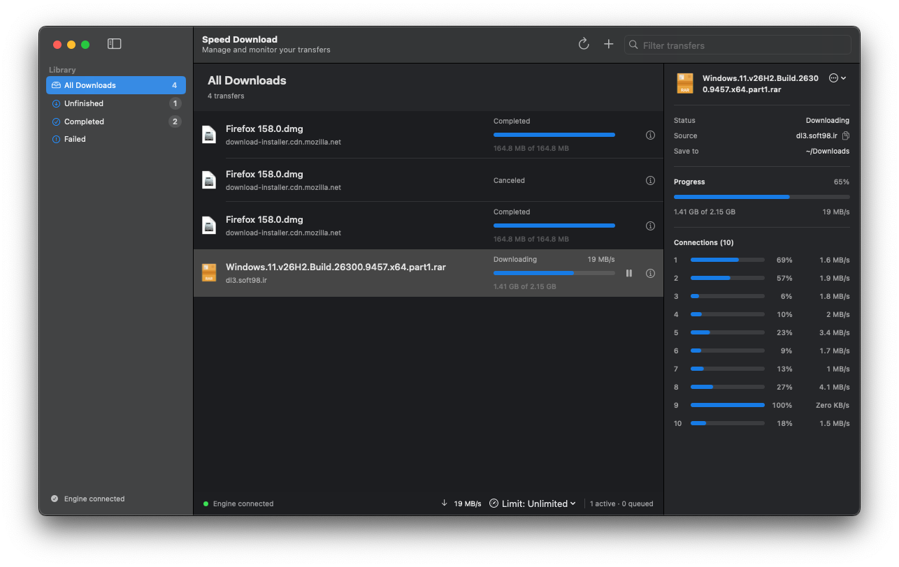

# Speed Download

<p align="center">
  
</p>

A free, open-source download manager with a Zig engine and native desktop clients.
Speed Download is in active development, with macOS as the current focus.



## Features

- **Parallel downloads:** multiple connections per HTTP(S) download, with automatic fallback when the server does not support byte ranges.
- **Pause and resume:** persistent queues and download checkpoints, with checks to avoid resuming changed content.
- **Named queues:** main is the default; create and rename other queues in the sidebar. Each queue has its own concurrent download limit, weekly start/stop schedule, and completion action.
- **Bandwidth controls:** global and per-download limits, plus scheduled limits for times such as office hours.
- **Transfer details:** total download speed, per-task progress, and an inspector showing individual worker progress.
- **Torrent and magnet review:** choose files, edit trackers, and select a destination before queueing a BitTorrent v1 download.
- **Browser integration:** send a link or links from a selected area of a page to the client; optionally intercept browser downloads. Save the reference page to recapture expired links through the browser.
- **Native macOS integration:** menu bar controls, notifications, launch at login, file icons, and `.torrent` and `magnet:` registration.

The GUI starts the bundled engine when needed. Transfers are managed by the engine,
so closing a client window does not stop them.

## Current availability

| Component | Status |
| --- | --- |
| macOS client | Runnable SwiftUI app; requires macOS 14 or later. |
| Linux client | GTK 4 client builds and passes connection, live progress, and engine restart smoke tests on Ubuntu. |
| Windows client | WinUI 3 / Fluent UI is the target. Current alpha ZIPs ship a temporary WPF client; x64 and ARM64 CI smoke passes, but WinUI startup remains blocked. |
| Engine and CLI | Persisted named queues and settings; HTTP(S) probing, safe resume and multipart; initial anonymous FTP/FTPS; experimental BitTorrent v1 magnets and `.torrent` transfers. See the [engine feature status](docs/engine-feature-status.md). |
| Browser extensions | Experimental Chrome and Firefox extensions for the macOS client. |

FTP/FTPS interoperability and BitTorrent transfers against live swarms still need
validation. BitTorrent seeding and v2-only transfers are not implemented; compatible hybrid torrents use the v1 transfer path. Browser
extensions are development builds; live-browser validation and store distribution
remain outstanding. See the [support matrix](docs/support-matrix.md) for detailed
platform and feature limitations.

## Build and run

### macOS app

Prerequisites: **Zig 0.17.0**, **Swift 6**, and the macOS SDK supplied by Xcode or
its Command Line Tools.

```sh
git clone https://github.com/MJKhaani/SpeedDownload.git
cd SpeedDownload
bash macos/SpeedDownload/package-app.sh
open "dist/Speed Download.app"
```

The bundle includes the engine and browser native-messaging helper. Add a download
with **⌘N**, paste a link with **⇧⌘V**, or drop a link onto the window. Open a
`.torrent` file or magnet link to review its files and trackers before downloading.
Configure the download folder, connections, proxy, bandwidth, browser grabbing,
and sidebar in **Speed Download → Settings…**. Queue schedules and completion
actions are under each queue's **⋮** menu in the sidebar.

### Engine and CLI

From the repository root:

```sh
zig build -Doptimize=ReleaseSafe
./zig-out/bin/speed-download --help
./zig-out/bin/speed-download engine
```

The engine runs locally and saves queue state and settings for the current user.
On macOS, its state is stored in `~/Library/Application Support/Speed Download`.
Set `SPEED_DOWNLOAD_STATE_DIR` to use a different state directory.

### Browser extensions

Follow the setup instructions for [Chrome](docs/browser-chrome.md) or
[Firefox](docs/browser-firefox.md). A single link opens the client's Add dialog;
multiple links open a review dialog with checkboxes. Torrent links open the torrent
review dialog. Downloads start after confirmation in the client.

The extension communicates with the **client**, which communicates with the engine.
Automatic browser download interception is off by default. When enabled, it
offers downloads whose file extensions match the list in Browser settings.

## Development

The engine owns transfers, scheduling, and persistence. Native clients communicate
with it through local IPC: SwiftUI on macOS, GTK 4 on Linux, and the current WPF compatibility client on Windows. The planned Windows client is WinUI 3 with Fluent UI.

- [Project plan and requirements](PROJECT.md)
- [Engine implementation inventory and remaining gaps](docs/engine-feature-status.md)
- [Contribution workflow](Agent.md)
- [Architecture decision](docs/adr/0001-native-guis-local-ipc.md)
- [IPC protocol](docs/protocols/ipc-v1.md) and [download state model](docs/download-state-machine.md)
- [FTP/FTPS details](docs/protocols/ftp.md) and [BitTorrent details](docs/protocols/torrent.md)
- [Windows WinUI 3 client](windows/SpeedDownload/README.md), [Windows WPF compatibility client](windows/SpeedDownload.Wpf/README.md), and [Linux client](linux/SpeedDownload/README.md)

GitHub Actions includes [platform checks](.github/workflows/phase0.yml) and a
[tag build workflow](.github/workflows/tag-build.yml) for tags matching `v*`.
Tagged builds contain the native client and engine together: macOS DMGs for
Apple Silicon and Intel, Windows ZIPs for x64 and ARM64, and a Linux x64
tar.gz. The workflow attaches SHA-256 checksums to the GitHub release.
macOS alpha builds are not notarized; Linux needs GTK 4 and JSON-GLib from the
distribution. See the [support matrix](docs/support-matrix.md) before using an
experimental platform build.

## License

Speed Download is licensed under the [MIT License](LICENSE).
Third-party components retain their own licenses; see [dependency notices](docs/licenses.md).
