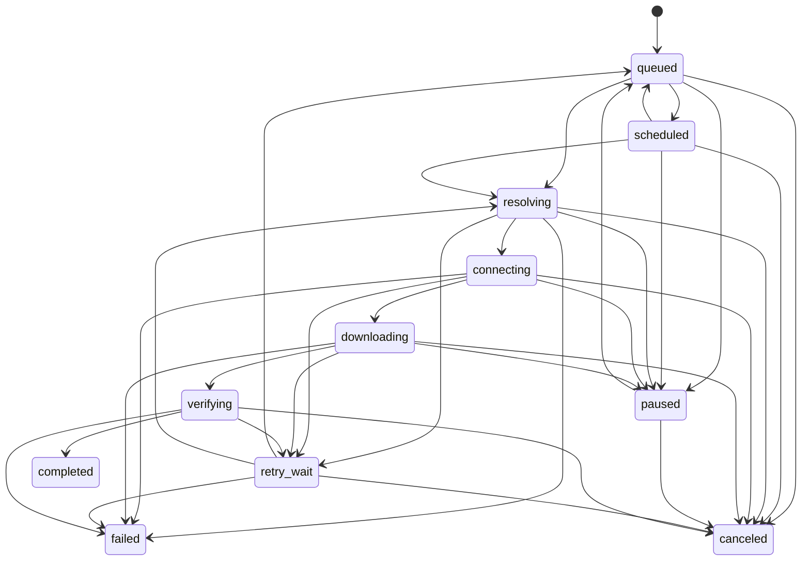

# Download State Machine

The core defines the state vocabulary and legal transitions. The engine
persists queued jobs, runs one HTTP(S) transfer worker at a time, and supports
queue pause/resume/cancel plus explicit start and retry. Controls do not
interrupt an active network transfer yet.

Repeated transitions and transitions out of `completed`, `failed`, or
`canceled` are rejected. Restarting a terminal job requires a new job ID so
that prior history and partial-file ownership remain unambiguous. A paused job
returns through `queued` before it can resolve or connect again.

`Progress` reports completed bytes and an optional total. Its fraction is
unknown when the total is unknown, `1` for a known empty resource with zero
completed bytes, and unknown when completed bytes exceed the total. This keeps
invalid counters from appearing as valid progress.

The engine-owned job store permits `start` from `queued` or `retry_wait`,
`pause` from `queued` or `scheduled`,
`resume` from `paused` or `retry_wait` back to `queued`, and `cancel` from
queued, scheduled, paused, or retry-wait states. Every accepted change
increments the job revision and is atomically persisted before the RPC
response. On startup, any persisted `resolving`, `connecting`, `downloading`,
or `verifying` job is moved to `retry_wait` and persisted before the engine
serves clients. The GUI displays it for an explicit user resume. Active-transfer
controls remain unavailable until workers have explicit cancellation and
ownership semantics. The current scheduler is a one-worker gate; the host-aware
multi-job policy remains unconnected. Progress snapshots are persisted at the
downloader's durable checkpoints: data is synced, then the resume journal is
atomically replaced, then the job byte count is atomically replaced. A crash
between these writes can leave the job count behind the journal, which is safe;
the next explicit retry reloads the journal offset and corrects the count. For
transfers without a resumable journal, byte counts are persisted after the file
is synced. The count represents durable downloaded bytes, not checksum-verified
bytes; completion is not reported until final validation and publication pass.

The separate queue policy selects only `queued` jobs, enforces global and
per-host active limits, then ranks by priority, least-loaded eligible host, and
FIFO sequence. It is a deterministic core primitive and is not yet used by the
single-worker engine dispatch path.

Future worker improvements must preserve these rules and add cooperative
cancellation and worker ownership semantics before exposing controls for active
transfers.
