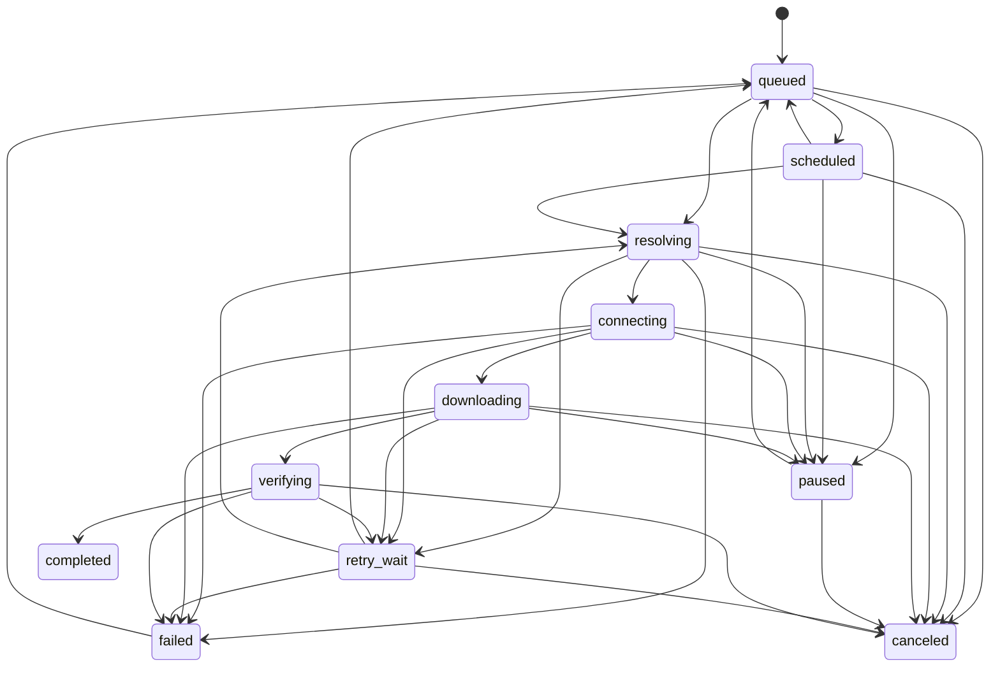

# Download State Machine

The core defines the state vocabulary and legal transitions. The engine
persists queued jobs, drains them through a host-aware scheduler (four workers
globally, two per host), and supports queue pause/resume/cancel plus explicit
start and retry. Active pause/cancel requests are persisted and take effect at
the next downloader progress check; a network read that has not returned data
can delay that check.

Repeated transitions and transitions out of `completed` or `canceled` are
rejected. A failed job can be explicitly retried into `queued`; a paused job
also returns through `queued` before it can resolve or connect again. A
canceled job is final and requires a new job ID to restart.

`Progress` reports completed bytes and an optional total. Its fraction is
unknown when the total is unknown, `1` for a known empty resource with zero
completed bytes, and unknown when completed bytes exceed the total. This keeps
invalid counters from appearing as valid progress.

The engine-owned job store permits `start` from `queued` or `retry_wait`,
`pause` from `queued`, `scheduled`, or `retry_wait`,
`resume` from `paused` or `retry_wait` back to `queued`, `retry` from `failed`
to `queued`, and `cancel` from
queued, scheduled, paused, or retry-wait states. Every accepted change
increments the job revision and is atomically persisted before the RPC
response. On startup, persisted `resolving`, `connecting`, `downloading`,
and `verifying` jobs are recovered before the engine serves clients. Active
control leaves the state `downloading` while its
`requested_control` is pending; after the worker exits it becomes `paused` or
`canceled`. Pause preserves a validator-backed `.part` file and journal.
Unresumable partial data is discarded by the downloader. Cancel always removes
the `.part` and journal after the worker closes them. A restart resolves a
pending pause/cancel before serving clients and removes partial data for a
pending cancel. The scheduler enforces the configured global task limit and
two active tasks per host. A destination filename already present on disk or
reserved by another unfinished job is rejected when a new job is added.
The scheduler also skips any older duplicate job while another job with the
same destination path is active, so they cannot write the same `.part` file.
Progress snapshots are persisted at the
downloader's durable checkpoints: data is synced, then the resume journal is
atomically replaced, then the job byte count is atomically replaced. A crash
between these writes can leave the job count behind the journal, which is safe;
the next retry reloads the journal offset and corrects the count. For
transfers without a resumable journal, byte counts are persisted after the file
is synced. The count represents durable downloaded bytes, not checksum-verified
bytes; completion is not reported until final validation and publication pass.

The queue policy selects only `queued` jobs, enforces global and per-host
active limits, then ranks by priority, least-loaded eligible host, and FIFO
sequence. Jobs accept a persisted integer priority from -100 to 100; the
macOS add form offers low, normal, and high values. Creation order is the FIFO
sequence when priorities and host load tie.
Starting a saved job retains its last durable byte count while the downloader
validates the partial file. The first worker report replaces that provisional
display count with the verified journal position.

Transient connection failures, truncated responses, and HTTP 429 or 503 enter a durable
`retry_wait` state for up to three automatic attempts, with delays of 2, 4,
and 8 seconds. When a 429 or 503 response includes `Retry-After`, the engine
uses the larger of that delay and its normal backoff, capped at one hour.
Both delta seconds and HTTP dates are accepted. The next attempt time and attempt count are stored with the
job. The scheduler promotes due retries to `queued`, then applies the same
global and per-host limits as ordinary jobs. A user can pause, cancel, or
retry immediately while waiting. Integrity, validation, and destination
errors fail without automatic retry. The five-second scheduler tick can add
up to five seconds to the nominal backoff. A manual retry from `failed` or
resume from `retry_wait` resets the automatic attempt count.
For HTTP 429/503, the next attempt also uses at most half as many connections,
down to one. This per-job cap survives restart; manual retry after failure
restores the configured default.

Future worker improvements should make network reads directly interruptible so
active pause/cancel does not need to wait for the next read to return, while
preserving per-job ownership and checkpoint ordering.
