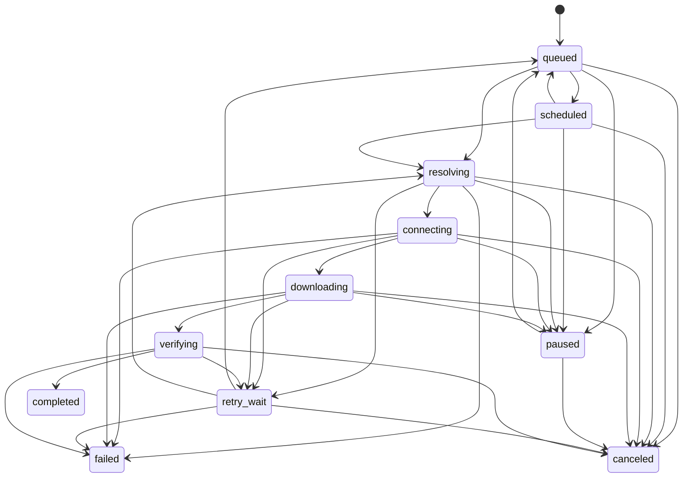

# Download State Machine

The core defines the state vocabulary and legal transitions. The engine
persists queued jobs and currently supports pausing or canceling a queued job,
and resuming a paused job through IPC. Transfer workers are not connected, so
controls do not interrupt an active network transfer yet.

Repeated transitions and transitions out of `completed`, `failed`, or
`canceled` are rejected. Restarting a terminal job requires a new job ID so
that prior history and partial-file ownership remain unambiguous. A paused job
returns through `queued` before it can resolve or connect again.

`Progress` reports completed bytes and an optional total. Its fraction is
unknown when the total is unknown, `1` for a known empty resource with zero
completed bytes, and unknown when completed bytes exceed the total. This keeps
invalid counters from appearing as valid progress.

The engine-owned job store permits `pause` from `queued` or `scheduled`,
`resume` from `paused` back to `queued`, and `cancel` from queued, scheduled,
paused, or retry-wait states. Every accepted change increments the job revision
and is atomically persisted before the RPC response. Active-transfer controls
remain unavailable until workers have explicit cancellation and ownership
semantics.

The separate queue policy selects only `queued` jobs, enforces global and
per-host active limits, then ranks by priority, least-loaded eligible host, and
FIFO sequence. It is a deterministic core primitive; no queue persistence,
worker dispatch, or user controls are wired to it yet.

Future worker integration must preserve these rules and add cancellation and
worker ownership semantics before exposing controls for active transfers.
